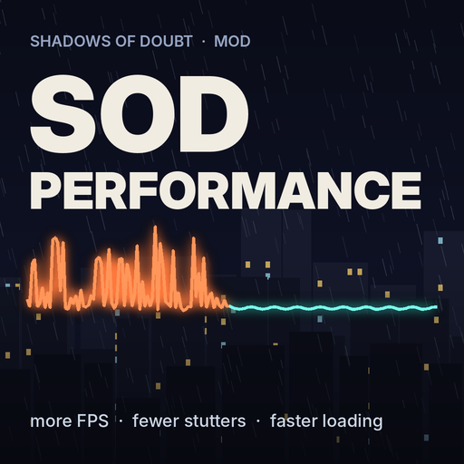

<h1 align="center">SOD Performance</h1>

<b>Shadows of Doubt, but smooth.</b> 
Higher FPS, far fewer stutters and faster city loading, above all in big cities.

<a href="https://thunderstore.io/c/shadows-of-doubt/p/Adronyus/SOD_Performance/">Thunderstore</a> ·
<a href="https://steamcommunity.com/sharedfiles/filedetails/?id=3845007837">Steam Workshop</a> ·
<a href="https://www.nexusmods.com/shadowsofdoubt/mods/67">Nexus Mods</a> ·
<a href="https://mod.io/g/shadows-of-doubt/m/sod-performance">mod.io</a> ·
<a href="../../releases">Downloads (Releases)</a> ·
<a href="docs/HOW-IT-WORKS.md">How it works</a>

---

SOD Performance is a mod for **Shadows of Doubt** that removes the biggest causes of stutter and slow loading. The game itself stays exactly the same: same city, same citizens, same rules. Only the way the work is done changes, and every fix can be switched off on its own.

## Results

Tested in a **2,120-citizen city**, same session, switching between vanilla and the mod with F10:

| Measured | Vanilla | SOD Performance |
|---|---|---|
| Average FPS | 46.6 | **72** (+55%) |
| Worst 1% of frames | 86 ms | **36 ms** |
| Stutters per minute | 68 | **9.6** (-86%) |

**Loading:** the same city went from about 210 s (an early build without the loading fixes) to about 107 s.
Results depend on your PC and city, but **the bigger the city, the bigger the gain**.

## Which version do I need?

There are two versions with **exactly the same fixes**. They differ only in how the game loads them. Install **one** of them.

| You use... | Get | Needs |
|---|---|---|
| r2modman / Thunderstore Mod Manager | [Thunderstore](https://thunderstore.io/c/shadows-of-doubt/p/Adronyus/SOD_Performance/) | nothing else (BepInEx comes automatically) |
| BepInEx, installed by hand | `SODPerformance-1.0.0-BepInEx.zip` from [Releases](../../releases) or [Nexus Mods](https://www.nexusmods.com/shadowsofdoubt/mods/67) | BepInEx 6 IL2CPP |
| Steam Workshop | [Workshop page](https://steamcommunity.com/sharedfiles/filedetails/?id=3845007837) | SOD Extender (one-time install) |
| The game's mod.io menu | [mod.io page](https://mod.io/g/shadows-of-doubt/m/sod-performance) | SOD Extender (one-time install) |
| SOD Extender, without Steam Workshop | `SODPerformance-1.0.0-Workshop-folder.zip` from [Releases](../../releases) | SOD Extender |

If you're unsure: use **Thunderstore**. It's one click and sets up everything.

## Install guides

### A) Thunderstore (easiest)
1. Install [r2modman](https://github.com/ebkr/r2modmanPlus/releases) or the [Thunderstore Mod Manager](https://get.thunderstore.io/) and choose Shadows of Doubt.
2. Search for **SOD Performance** and click **Install**. BepInEx is installed with it.
3. Start the game with **Start modded** in the mod manager.

### B) BepInEx by hand
1. Download [BepInExPack IL2CPP](https://thunderstore.io/c/shadows-of-doubt/p/BepInEx/BepInExPack_IL2CPP/) (version 6.0.755 or newer).
2. Steam → Shadows of Doubt → right click → Manage → **Browse local files**. Unzip BepInEx into that folder, so that `BepInEx` sits next to `Shadows of Doubt.exe`.
3. Start the game once and wait for the main menu (the first start takes a few minutes longer), then close it.
4. Download `SODPerformance-1.0.0-BepInEx.zip` from [Releases](../../releases) and unzip it into the same game folder. The files end up in `BepInEx/plugins/SODPerformance/`.
5. Start the game. `BepInEx/LogOutput.log` shows `SOD Performance 1.0.0 loaded`.

### C) Steam Workshop (with SOD Extender)
Steam can't run code mods on its own. SOD Extender is a one-time install that lets the game load code mods from the Workshop.
1. Download SOD Extender: open [SOD Extender on GitHub](https://github.com/XRenso/sod-extender/releases) and, under **Assets** of the newest release, click `SodExtender-0.3.0.zip` (or newer).
2. Steam → Shadows of Doubt → right click → Manage → **Browse local files**. Unzip the whole download into that folder (next to `Shadows of Doubt.exe`) and replace files if asked.
3. Subscribe to [SOD Performance on the Workshop](https://steamcommunity.com/sharedfiles/filedetails/?id=3845007837).
4. Start the game. The first start takes 1-2 minutes longer (it happens again after game updates).
5. Main menu → **Mods**: make sure SOD Performance is enabled. The **SOD Extender** button shows that it loaded.

### D) SOD Extender without the Workshop
1. Install SOD Extender as in C), steps 1-2.
2. Download `SODPerformance-1.0.0-Workshop-folder.zip` from [Releases](../../releases).
3. Press Win+R, paste `%USERPROFILE%\AppData\LocalLow\ColePowered Games\Shadows of Doubt\Mods` and press Enter. Unzip the download there, so you get a `SOD Performance` folder inside `Mods`.
4. Start the game and enable the mod in the **Mods** menu.

> **Only one copy can run.** If you switch from the BepInEx version to the Workshop version (or back), remove the other one first. If both are installed, the first one to load runs and the other stays off (the log says so).

## Keys

| Key | What it does |
|---|---|
| **F10** | All optimizations on/off: compare with vanilla at any moment |
| **F8** | Performance overlay (FPS and frame times) |
| **F7** | Writes a detailed performance report to `BepInEx/SODPerformance/` |

## Settings

The settings file is created on the first start. Edit it with the game closed.
- BepInEx / Thunderstore version: `BepInEx/config/com.adronyus.sod.performance.cfg`
- Workshop / SOD Extender version: `BepInEx/config/SodMods/SOD Performance.cfg`

Every fix has its own switch. The most useful ones:

| Setting | Default | What it does |
|---|---|---|
| `[General] OptimizationsEnabled` | true | Master switch (same as F10) |
| `[AI] FrameBudgetMs` | 4 | Time for citizen decisions per frame (0 = vanilla) |
| `[AI] StaggerFarMovement` | true | Spread far-away citizens' movement over time |
| `[Rooms] SmoothRoomContentLoading` | true | Load furniture nearest-first in small steps |
| `[Rooms] SpreadFarRoomShowing` | true | Show far rooms over a few frames |
| `[Rooms] ShowMaxDelayMs` | 250 | The longest a far room may wait before it appears |
| `[Rooms] FastBreakerLookup` | true | Find breaker boxes through an index |
| `[Loading] RoomVisibilityCache` | true | Save room visibility per city on disk |
| `[Loading] FastPresetCompare` | true | The faster loading comparison |
| `[Shadows] DistanceScale` | 0.5 | Lamp shadow distance (1 = vanilla) |
| `[CPU] PreferVCacheCores` | true | AMD X3D CPUs: keep the game on the V-Cache cores |
| `[Profiler] Enabled` | false | Detailed per-system timing in the F7 report (small overhead) |

## What it fixes

Most stutters in Shadows of Doubt are **not a graphics problem**. The game's logic runs mostly on one CPU thread, and a few systems do far too much work in a single frame, more so the bigger the city. That's why graphics settings, DLSS or V-Sync barely help.

- **Citizens moving in lockstep:** all far-away citizens were moved in the same frame (about 1,900 every 3.4 s in a big city, a ~110 ms freeze). Now spread evenly; each citizen still moves as often as before.
- **AI decisions piling up:** decisions were limited per frame by count, not by time, so a few slow ones (fights, crowds) stacked into a freeze. Now they get a 4 ms budget per frame.
- **Stutters at every door:** rooms and their furniture (20-30 ms per room) were loaded all in one frame. Now nearest-first over a few frames, never later than a quarter of a second.
- **Freezes in new rooms:** room visibility was recalculated for the whole city on every load, with 100-300 ms freezes when you walked in too early. Now saved per city.
- **Slow loading:** a slow, locked type lookup ran millions of times while building a city's evidence (about 55 s of a 138 s load). Replaced with a comparison that gives exactly the same result.
- **Breaker box search, shadows nobody sees, sound updates, log spam, X3D CPUs:** smaller fixes, see [How it works](docs/HOW-IT-WORKS.md).

The full story, including what didn't work, is in **[docs/HOW-IT-WORKS.md](docs/HOW-IT-WORKS.md)**.

## FAQ

**What does F7 do?** It saves a text report about how the game runs on your PC to `BepInEx/SODPerformance/`: your CPU and GPU model, FPS and worst frames with the mod on and off, every stutter and what the game was busy with, how long each loading step took, memory use, and what each fix did. Open it with Notepad. It's only for you: nothing is uploaded or sent anywhere.

**Does it change my game or saves?** No. Same simulation, same rules, nothing is written into your saves. You can remove it at any time.

**Some lamps look brighter.** Their shadows fade out earlier. Set `[Shadows] DistanceScale = 1` for the vanilla look.

**Still some stutters?** A few remain from Unity's memory cleanup, plus a one-time freeze right after a city finishes loading. Both are in the vanilla game too.

**After a game update?** Each fix checks the game at start-up and switches itself off if something it relies on has changed, instead of breaking the game. Check `BepInEx/LogOutput.log` for messages from SOD Performance.

**Uninstall:** remove `BepInEx/plugins/SODPerformance/` (BepInEx version), unsubscribe or disable it in the Mods menu (Workshop version). You can also delete `BepInEx/cache/SODPerformance/`.

## Building from source

See **[docs/BUILDING.md](docs/BUILDING.md)**. In short: .NET SDK 6+, a game folder with BepInEx 6 IL2CPP installed and started once (for the game's generated interop assemblies), SOD Extender 0.3.0 for the Workshop version, and MinGW-w64 for the small native helper. This repository contains only original code; no game files are included.

## Project layout

| Path | What |
|---|---|
| `src/` | All fixes, the overlay, the report and the profiler (shared by both versions) |
| `src/Plugin.cs` | Entry point of the BepInEx version |
| `workshop/` | Entry point of the Workshop version (a SOD Extender code mod) |
| `native/sodsampler.c` | Native helper: the fast preset comparison and the optional sampling profiler |
| `package/` | Builds all release packages; texts for the Workshop and Thunderstore pages |
| `art/` | Preview image and icon (generated by `make_art.py`) |

## Licence and credits

MIT, see [LICENSE](LICENSE). Made by **Adronyus**.
Thanks to ColePowered Games for Shadows of Doubt, to the BepInEx and Il2CppInterop teams, and to XRenso for [SOD Extender](https://github.com/XRenso/sod-extender).
Not affiliated with ColePowered Games.
